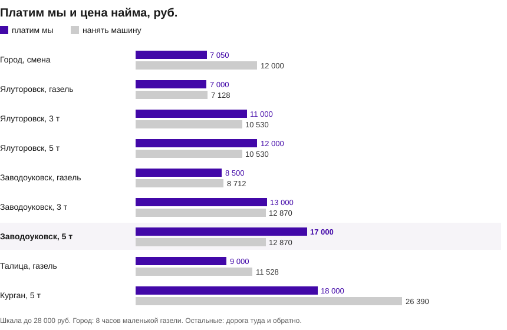

# Сколько мы платим водителям

Платим только сумму по тарифу. Топливо и ремонт водитель оплачивает сам. Сверка 13 ноября 2026 года.

График и таблица на странице: [arimberg-svg.github.io/tarify-dostavki-tyumen](https://arimberg-svg.github.io/tarify-dostavki-tyumen/).

Минус — платим меньше найма. Плюс — платим больше. Город: 8 часов маленькой «Газели». Остальные города: туда и обратно.

| Рейс | Платим мы | Нанять | Разница |
| --- | ---: | ---: | ---: |
| Город, смена с точками | 7 050 ₽ | 12 000 ₽ | −4 950 ₽ |
| Одна точка по городу | 2 500–3 400 ₽ | 3 000–4 250 ₽ | дешевле найма |
| Фикс, полная смена | 8 500 ₽ | 12 000–16 000 ₽ | дешевле найма |
| Ялуторовск, газель | 7 000 ₽ | 7 128 ₽ | −128 ₽ |
| Ялуторовск, 3 т | 11 000 ₽ | 10 530 ₽ | +470 ₽ |
| Ялуторовск, 5 т | 12 000 ₽ | 10 530 ₽ | +1 470 ₽ |
| Заводоуковск, газель | 8 500 ₽ | 8 712 ₽ | −212 ₽ |
| Заводоуковск, 3 т | 13 000 ₽ | 12 870 ₽ | +130 ₽ |
| Заводоуковск, 5 т | 17 000 ₽ | 12 870 ₽ | +4 130 ₽ |
| Талица, газель | 9 000 ₽ | 11 528 ₽ | −2 528 ₽ |
| Курган, 5 т | 18 000 ₽ | 26 390 ₽ | −8 390 ₽ |
| Курган, 3 т | 14 000 ₽ | ниже круга | дешевле круга |
| Курган, газель | нет цены | 5 400–6 000 ₽ в одну сторону | поставить цену |
| После 60 км, газель | 65 ₽/км | 40–50 ₽/км | снизить до 45–50 |
| После 60 км, 5 т | 65 ₽/км | от 65 ₽/км | оставить |
| Простой | 600 ₽/час | час оклада около 450 ₽ | оставить |
| Погрузка за день | 500 ₽ | грузчик 450–550 ₽/час | мало, если грузит водитель |

## Выводы

1. Городскую смену с точками оставляем: 7 050 ₽ против 12 000 ₽ за найм.
2. Ялуторовск, Талицу и Заводоуковск на газели оставляем. Заводоуковск на 3 т тоже оставляем.
3. Заводоуковск, 5 т, пересмотреть: 17 000 ₽, это на 4 130 ₽ дороже найма.
4. После 60 км на газели снизить ставку с 65 до 45–50 ₽/км. Полосу «до 60 км» у газели 2–2,5 т поднять: сейчас плюс 50 ₽, а бензин этих 10 км стоит около 80 ₽.
5. Простой 600 ₽/час оставляем. 500 ₽ за погрузку на весь день мало, если водитель грузит сам.

Источники на 13 ноября 2026 года: [Буряков](https://tyumen.buryakof.ru/tarify), [Автофлот](https://tyumen.avtoflot.ru/tseny/), [Tungus Trans](https://tungustrans.ru/gruzoperevozki-po-rossii/tjumen-kurgan/), [Альфа-64](https://alfa-64.ru/napravleniya/gruzoperevozki-tyumenkurgan/), [MTP](https://mtp-cargo.ru/tyumen/kurgan), [вакансии hh.ru](https://tyumen.hh.ru/vacancies/voditel_gazeli).
